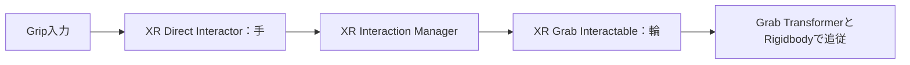

試作 v0.1｜更新：2026-09-27｜対象：Unityの基本操作を一度経験したVR部員
**今日のゴール：輪が落ちる理由を説明でき、必要な部品を自分で設定してコントローラーで掴める。さらに、掴んだことをスクリプトで受け取れる。**
所要時間の目安：60〜90分＋実機へのビルド待ち（授業実施による計測前）。
> このページは授業試行用です。既存の完成作品はQuest 2の単体アプリで成功報告がありますが、このページを最初から最後まで部員が再現する試験は未実施です。各節の「期待する結果」は新たな確認済み結果ではありません。
<table_of_contents/>

# 0. 用意するもの・今回作る範囲
配布済みプロジェクト `VR_RingToss_Tutorial` を使用します。空の新規プロジェクトからXR環境を作る教材ではありません。配布担当からこのプロジェクト一式を受け取ってください。このNotionページだけではシーンや輪のメッシュは入手できません。
- Unity：6000.3.9f1
- XR Interaction Toolkit：3.3.1／OpenXR Plugin：1.16.1／Input System：1.18.0
- 実機：Quest 2とコントローラー。今回はハンドトラッキングを使いません。
- 事前準備：このプロジェクトでQuest 2へのBuild And Runができること。初回の端末接続・Android環境構築は担当者と済ませます。
**配布するもの：** 床、照明、VRプレイヤー、左右の入力、輪の見た目、円周に沿った16個のCollider、前方配置用スクリプト。
**自分で組み立てるもの：** Rigidbody、掴む設定、Grab Transformerの参照、イベントを受け取る短いスクリプト。
本時は投擲調整、右Aで戻す機能、的、得点、UIを作りません。パッケージや共通Input Actionsも変更しません。

# 1. 自分用シーンと、輪の出発点を作る
## 操作
1. UnityのPlayを停止します。別の作業が未保存なら先に保存します。
2. Projectで `Assets/RingTossTutorial/Scenes/Lessons/01_Grab_Starter.unity` を開きます。
3. ProjectのAssets内に `MyPractice` フォルダーを作ります。
4. File → Save Asで `Assets/MyPractice/My_01_PhysicsGrab.unity` に保存します。以後、自分用シーンで作業します。
5. Hierarchyの `Ring` を選びます。Inspector各コンポーネント右上のメニュー → Remove Componentで、次の順に取り外します。
- `Ring Return To Player`
- `Ring Initial Placement`
- `XR Grab Interactable`
- `XR General Grab Transformer`
- `Rigidbody`
この順序は依存関係のためです。「他のコンポーネントが必要としている」と表示されたら、上から順に外したか確認します。
6. Ringに残すのはTransform、Mesh Filter、Mesh Rendererです。子の `Collider_00`〜`Collider_15` は残します。床・XR Origin・入力には触れません。
7. RingのTransformをPosition `(0, 1.25, 0.45)`、Rotation `(0, 0, 0)`、Scale `(1, 1, 1)` にします。Ctrl+Sで保存します。

## 確認
Hierarchyの構成は次のとおりです。Controllerの補助表示など、配布済みの子は残して構いません。
```text
Floor
Directional Light
XR Interaction Manager
XR Origin
  Camera Offset
    Main Camera
    Left Controller
    Right Controller
Ring
  Collider_00
  …
  Collider_15
```
SceneビューでRingを選び、Fキーで表示を寄せます。Playを押し、Sceneビューで観察します。
**期待する結果：輪は落ちません。** 見た目とColliderだけでは、自分から重力で動く物体にはならないからです。確認後はPlayを停止します。
> Play中の変更は停止すると通常元に戻ります。この教材では、設定変更は停止中、動作観察はPlay中に行います。

# 2. Rigidbodyを付けて、落下させる
## 操作
1. Ringを選択 → Inspector下部のAdd Component → `Rigidbody` を検索して追加します。`Rigidbody 2D` ではありません。
2. 次の値を入力します。
<table header-row="true">
<tr><td>項目</td><td>値</td><td>理由</td></tr>
<tr><td>Mass</td><td>0.15</td><td>基準質量を0.15kgにする</td></tr>
<tr><td>Use Gravity</td><td>ON</td><td>まず重力で落下させる</td></tr>
<tr><td>Is Kinematic</td><td>OFF</td><td>物理計算で動かす</td></tr>
<tr><td>Interpolate</td><td>Interpolate</td><td>描画時の動きを補間する</td></tr>
<tr><td>Collision Detection</td><td>Continuous Dynamic</td><td>速い動きでの衝突検出を補助する</td></tr>
</table>
3. ConstraintsのFreeze Position／RotationはすべてOFFにします。
4. 保存してPlayを押します。Ringを選んだままSceneビューで落下を観察します。
**期待する結果：輪が落ちて床に当たる。** 輪の姿勢によって揺れたり回転したりして構いません。
5. Playを停止します。Ringが編集時の初期位置に戻ることを確認します。

## 考えてから試す
Use GravityをOFFにするとどうなるでしょうか。予想を書いてから、停止中にOFFへ変更し、再度Playします。
**期待する結果：重力による落下がなくなる。** Use Gravityは「速度を常に0にする」設定ではありません。外力や他の処理で動く場合はあります。
停止してUse GravityをONへ戻します。

# 3. Colliderの役割を実験する
Mesh Filter／Mesh Rendererは見た目、Colliderは衝突の形、Rigidbodyは物理運動を担当します。
この輪では16個のCapsule Colliderを円周に沿って並べています。親のRigidbodyと子のCollider群で一つの物体として扱います。子にRigidbodyを追加しません。

## 操作と比較
1. 停止中にRingを展開します。Collider_00を選び、Shiftを押しながらCollider_15を選択して16個をまとめて選びます。
2. InspectorのCapsule Collider見出し左の有効チェックをOFFにします。GameObject自体のActiveチェックではありません。
3. Playで落下を観察します。
**期待する結果：輪の見た目は残るが床を通り抜ける。** 今は輪の衝突判定を取り外した状態だからです。
4. 停止し、16個のCapsule ColliderをすべてONに戻します。`Is Trigger` はすべてOFFにします。
5. 再度Playして床に当たることを確認し、停止します。
**問い：輪全体を一つの大きなBox Colliderで包むと、輪の穴はどう扱われるでしょうか。**
見た目に穴があっても、Colliderが穴を塞いでいればそこにも衝突します。今回、メッシュ制作と16個の配置は配布済みですが、物理形状の役割はこの比較で確かめます。
- [ ] Collider ON／OFFによる違いを自分の言葉で記録した。
- [ ] 16個すべてON、Is Trigger OFFに戻した。

# 4. 輪を「掴める対象」にする
ここからは落下実験を終え、前方で掴むのを待つ輪にします。
## 4-1. 掴むコンポーネントを追加する
1. 停止中にRingを選び、RigidbodyのUse GravityをOFFにします。
2. Add Componentで `XR Grab Interactable` を追加します。コンポーネントの有効チェックをONにします。
3. Interaction Manager欄へ、Hierarchyの `XR Interaction Manager` をドラッグします。
4. 次の設定を入力します。折りたたまれている項目は展開します。
<table header-row="true">
<tr><td>項目</td><td>この演習での値</td><td>役割</td></tr>
<tr><td>Interaction Layer Mask</td><td>Default</td><td>掴む側と対象を組み合わせる層</td></tr>
<tr><td>Select Mode</td><td>Single</td><td>同時に選択する手を一つにする</td></tr>
<tr><td>Movement Type</td><td>Velocity Tracking</td><td>Rigidbodyの速度で手に追従させる</td></tr>
<tr><td>Track Position／Track Rotation</td><td>ON／ON</td><td>手の位置・回転へ追従する</td></tr>
<tr><td>Use Dynamic Attach</td><td>ON</td><td>掴んだ時点の位置関係を使う</td></tr>
<tr><td>Attach Ease In Time</td><td>0.15</td><td>掴み位置への移行時間</td></tr>
<tr><td>Throw On Detach</td><td>OFF</td><td>投擲用の速度付与は次の教材で扱う</td></tr>
<tr><td>Force Gravity On Detach</td><td>OFF</td><td>離した際に重力を強制ONにしない</td></tr>
</table>
5. Collidersリストの要素数を16にします。Element 0〜15へ、HierarchyのCollider_00〜15を一つずつドラッグし、Capsule Collider参照を登録します。None／Missingや同じ子の重複がないか確認します。
Interaction Layer MaskはInspector上部のGameObjectのLayerとは別の設定です。

## 4-2. 手の動きを輪へ反映する部品を登録する
1. Ringへ `XR General Grab Transformer` を追加します。
2. Permitted Displacement AxesをAll、Allow One Handed ScalingとAllow Two Handed ScalingをOFFにします。
3. XR Grab InteractableのAdd Default Grab TransformersをOFFにします。
4. Starting Single Grab Transformersを1件にし、RingのXR General Grab Transformerを登録します。コンポーネントの見出しを参照欄へドラッグできます。
**なぜ登録する？** Interactableは選択される対象、Transformerは掴んだ手から輪の位置・回転などを求める部品です。今回は自動追加に頼らず、接続を自分で見える形にします。

## 4-3. 掴む側との対応を見る
`XR Origin → Camera Offset → Left Controller` と `Right Controller` を選び、配布済みの設定を確認します。
- XR Direct Interactor：Interaction Managerが設定済み。Interaction Layer MaskはEverythingで、輪のDefaultを含みます。
- Select Action Trigger：State Change
- Select Input：Input Action Reference。左は `XRI Left Interaction/Select` と `Select Value`、右は対応するRight側。
- Sphere Collider：Radius 0.08、Is Trigger ON
- Improve Accuracy With Sphere Collider：ON


ここでは入力参照を作り直しません。空欄なら共通の接続準備へ戻って担当者と確認します。
State Changeでは、**輪に近づけてからGripを押す**順で操作します。

# 5. 前方配置を接続して、実機で掴む
## 配布スクリプトを取り付ける
1. Ringへ、配布済みの `Ring Initial Placement` を追加します。
2. Head欄へ `XR Origin → Camera Offset → Main Camera` をドラッグします。
3. Forward Distanceを0.45、Below Eyesを0.35にします。
4. Ringの初期位置が `(0, 1.25, 0.45)`、RigidbodyのUse GravityがOFFであることを確認して保存します。

このスクリプトは頭の追跡が0.25秒続いた後、一度だけ目線の水平前方0.45m、下方0.35mへ輪を置きます。頭への常時追従ではありません。実機の向きがEditorの前方と一致しない問題を避けます。コードの詳しい実装は次の演習で扱います。
## Quest 2で確認
1. File → Build Profilesで、準備済みのAndroid用設定を開きます。
2. 使用するScene Listに `Assets/MyPractice/My_01_PhysicsGrab.unity` を追加します。Global Scene Listを使う構成ではそちらを確認します。
3. 自分のシーンを最初に起動する有効シーンにします。元の完成シーンを誤って起動しないよう、今回は他のシーンを無効にします。既存のビルド一覧は変更前に控え、演習後に戻せるようにします。
4. Build And RunでQuest 2へ入れます。視線を水平にして起動し、輪が前方へ出ることを確認します。
5. 輪の縁へコントローラーを近づけ、Gripを押し続けます。手をゆっくり動かし、回転させます。
6. Gripを離します。左右をそれぞれ試します。輪が遠くへ行ったらアプリを再起動します。本時は右Aで戻りません。
**期待する結果：掴む、保持中に位置・回転が追従する、離すと保持が終わる。**
Throw On DetachがOFFでも、Velocity Tracking中の速度などで離した後に動く場合があります。「必ず空中停止する」は合格条件にしません。Force Gravity On Detachだけで投げる機能が完成するわけでもありません。

# 6. スクリプトを書いて「掴んだ」を受け取る
手の追跡と掴む処理はXRIに任せ、掴みの開始・終了を自分のコードへ知らせます。
## 6-1. ファイルを作る
1. Playを停止し、Projectの `Assets/MyPractice` 内にScriptsフォルダーを作ります。
2. Scriptsを右クリック → Create → Scripting → MonoBehaviour Scriptで `RingGrabReporter` を作成します。
3. ファイルを開き、中身を次のコードへ置き換えて保存します。ファイル名は `RingGrabReporter.cs`、クラス名も同じにします。
```csharp
using UnityEngine;

public class RingGrabReporter : MonoBehaviour
{
    [SerializeField] private string ringLabel = "練習用の輪";

    public void ReportGrab()
    {
        Debug.Log(ringLabel + "を掴みました", this);
    }

    public void ReportRelease()
    {
        Debug.Log(ringLabel + "を離しました", this);
    }
}
```
4. Unityへ戻り、コンパイルが終わるまで待ちます。Consoleに赤いエラーがなければ、スクリプトをHierarchyのRingへドラッグします。
5. InspectorのRing Labelを自分の好きな名前に変えます。

## コードを読み解く
- `MonoBehaviour`：GameObjectへ取り付けられるUnityのスクリプトの基底クラス。
- `[SerializeField]`：privateの変数を保存対象にし、Inspectorから設定できるようにします。
- `string`：文字列の型です。ここでは輪の呼び名を保持します。
- `public void ReportGrab()`：外から呼び出せる、戻り値のないメソッド。書いただけでは自動実行されません。
- `Debug.Log(..., this)`：ログを出し、発信元としてこのコンポーネントを関連付けます。

## 6-2. イベントとメソッドを接続する
1. RingのXR Grab InteractableにあるInteractable Eventsを開きます。
2. Select Enteredの「＋」で1行追加し、参照欄へHierarchyのRingをドラッグします。
3. No Functionメニューで `RingGrabReporter → ReportGrab()` を選びます。引数なしのメソッドを選びます。
4. Select Exitedにも1行追加し、同じRingを登録して `RingGrabReporter → ReportRelease()` を選びます。
5. Ctrl+Sで保存します。Hover Enteredではなく**Select Entered**へ登録したか確認します。

**なぜUpdateを書かない？** 今回は毎フレーム監視せず、選択が始まった／終わったタイミングのイベントから呼んでもらいます。近づいた状態のHoverと、掴んだ状態のSelectは異なります。
## 6-3. ログを確かめる
Quest LinkでEditor Playへ入力を渡せる環境なら、Window → General → Consoleを開いてLog表示を有効にし、掴む／離すごとにメッセージを確認できます。ただし、本プロジェクトの既報の実機成功はLink方式ではありません。
**Build And Runの単体アプリでは、端末ログは通常Editor Consoleに自動表示されません。** 新しいコードを再ビルドしたうえで、担当者のADB環境で端末ログを確認します。ADBのあるターミナルで次を実行し、操作後の新しい行を見ます。
```text
adb logcat -s Unity
```
ADBが未設定なら、このログ確認欄は未確認にして担当者と行います。ログが見えないことと掴めないことを混同しません。
**期待する結果：Select Enteredで「○○を掴みました」、Select Exitedで「○○を離しました」。**
発展課題：文字列を変えて再ビルドし、InspectorのRing Labelの値がログに反映されることを確かめましょう。スクリプト内の初期文字列を後から変えても、既に保存されたInspectorの値は通常置き換わりません。

# 7. 困ったときの確認順
<table header-row="true">
<tr><td>症状</td><td>確認する場所</td></tr>
<tr><td>落下実験で落ちない</td><td>Rigidbody、Use Gravity ON、Is Kinematic OFF、位置Constraints、配置スクリプトを取り外したか</td></tr>
<tr><td>床を通り抜ける</td><td>16個のCapsule Colliderが有効・非Triggerか。FloorのBox Colliderが有効・非Triggerか</td></tr>
<tr><td>実機で輪が見つからない</td><td>起動シーン、Head参照、頭の追跡、Use Gravity OFF。Ringをカメラの子にして直さない</td></tr>
<tr><td>掴めない</td><td>輪へ近づいてからGripを押す。Grab有効、Manager、Colliders、Interaction Layerの共通部分を確認</td></tr>
<tr><td>掴めるが追従しない</td><td>Track Position／Rotation、Starting Single Grab Transformersの参照、RigidbodyのConstraints</td></tr>
<tr><td>ReportGrabがメニューにない</td><td>Consoleのコンパイルエラー、ファイル名とクラス名、public、Ringへスクリプトが付いているか</td></tr>
<tr><td>ログが二重に出る</td><td>イベントへの重複登録、同じスクリプトの重複追加</td></tr>
<tr><td>単体アプリのログがEditorに出ない</td><td>端末側のログを確認する。Editor Consoleだけで失敗と判定しない</td></tr>
</table>

# 8. 提出する記録
- [ ] 自分用シーンの保存パスを記入した。
- [ ] Rigidbody追加前／追加後の違いを説明できる。
- [ ] Collider OFF／ONの違いを説明できる。
- [ ] Use Gravity OFF、Collider16個ON・非Triggerへ戻した。
- [ ] 左右それぞれで取得・位置追従・回転追従・解放を試した。
- [ ] イベントとReportGrab／ReportReleaseを接続した。
- [ ] 実行方式と、実際に確認できた結果を記録した。未確認を成功扱いにしていない。
次を自分のメモへコピーして記入してください。
```text
実施日／名前：
Unity版：
保存したシーン：
機種：
実行方式：Quest単体（Build And Run）／Quest Link＋Editor Play
ビルド日時またはAPK名：
落下と床衝突：
Collider無効時との比較：
左手の取得・追従・解放：
右手の取得・追従・解放：
ログを確認した場所と結果：
Console／端末ログのエラー：
詰まった手順・直した箇所：
Rigidbody／Collider／XR Grab Interactableの役割を一文ずつ：
```

# 講師向け：根拠と試作の検証範囲
2026-09-27作成。既存の「設定を確認して有効チェックを入れる」初稿から、部品の再追加、比較実験、コード記述、イベント接続へ構成を変更しました。
**今回実際に確認したこと：** 接続中EditorからUnity・パッケージ版、完成シーンのRigidbody・XR Grab Interactable・左右入力参照、床と16個のColliderを読み取り。EditorはPlay停止中、完成シーンは未保存変更なし。イベント欄の実装は導入済みXRIのEditorソースも参照しました。Inspector画面の全手順を目視再現したという意味ではありません。
**既存の実機結果：** ユーザーによるQuest 2／Build And Run単体アプリで、前方配置・掴み・投擲・右Aで再投球の成功報告。現在の保存ファイルと試験APKの完全一致は識別子未記録のため未照合です。
**この新教材で未確認：** 取り外しから組み直しまでの通し操作、掲載した新規RingGrabReporterのコンパイル・イベント接続・実機ログ、学生による再現、Quest Pro／Quest 3S。本ページのチェック欄はその試行で埋めます。新しいスクリーンショットは未作成です。
この教材の作成に伴うUnityシーン・ランタイムスクリプト・Package設定・入力設定の変更はありません。教材内の操作は学習者が自分用シーンに行う手順です。
技術記録：配布プロジェクト内 `Docs/RingToss-v0.1/CurrentState.md` と `lesson-scene-checks.json`。従来の01_Grab_Completeは設定比較用であり、このページのログスクリプトまで含んだ完成例ではありません。
構成の参考：[Unityでの簡単なゲーム作成](https://app.notion.com/p/e7d21a05110d8211a17f0187718dd03c)、[『Roll a Ball』作成マニュアル](https://app.notion.com/p/35d21a05110d809a9827fe918a419f81)。旧資料のAPIや設定をそのまま転載せず、現行プロジェクトに合わせています。

